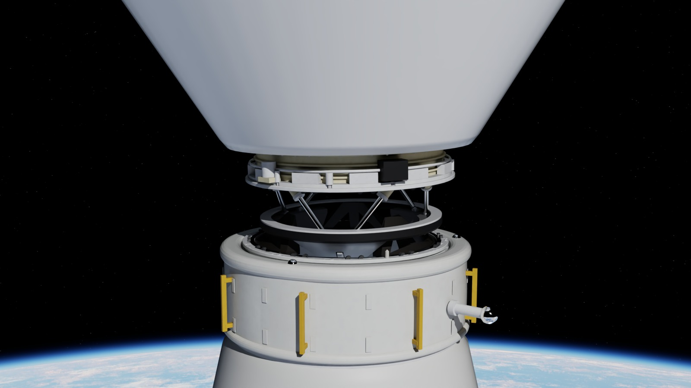
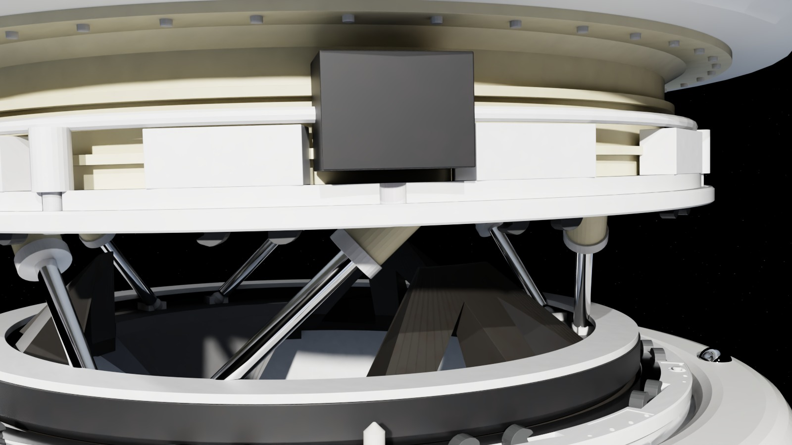
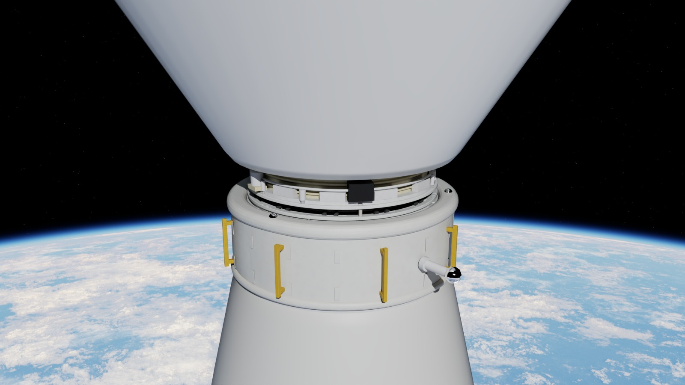
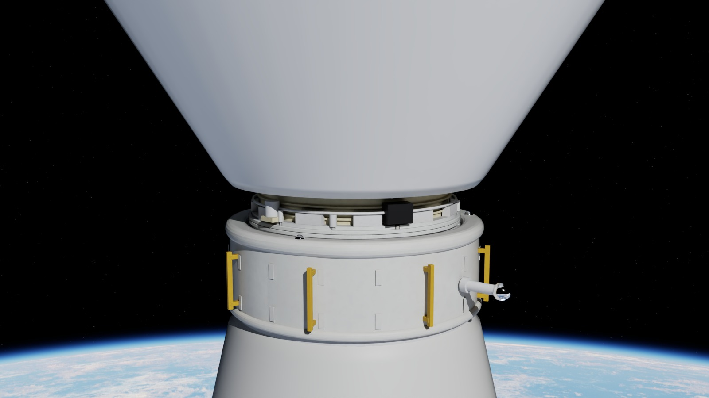
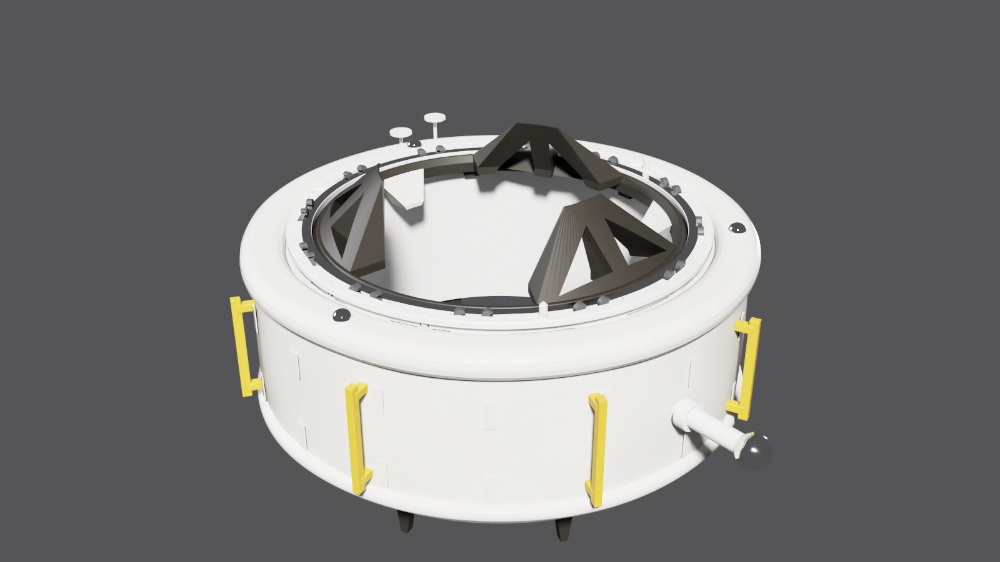
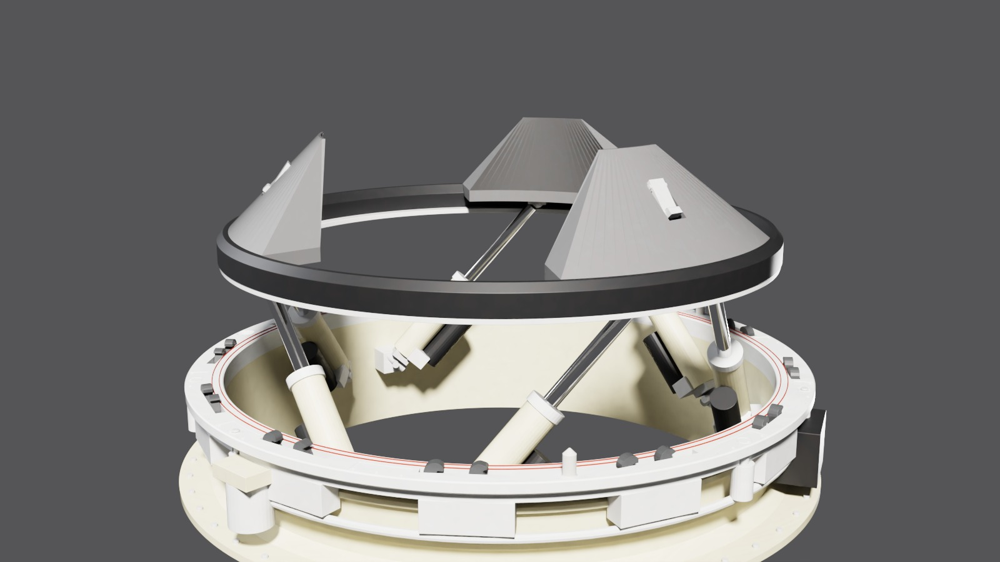
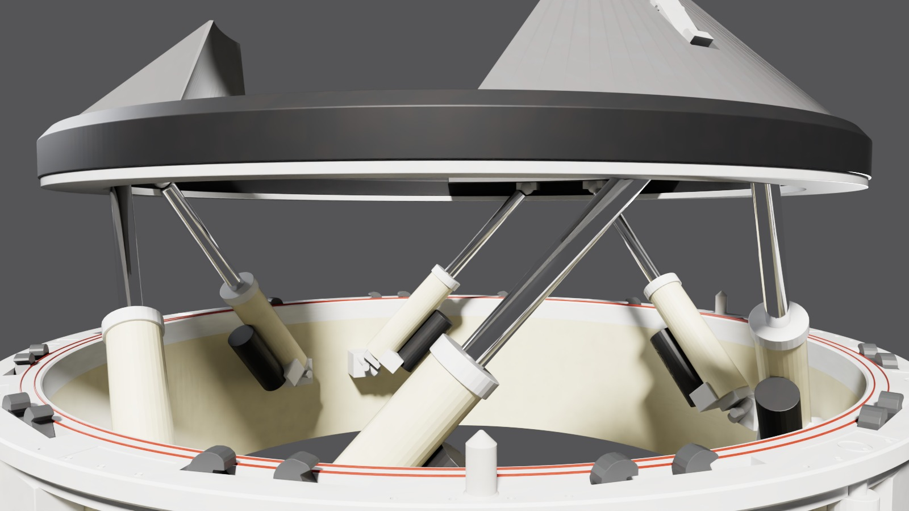
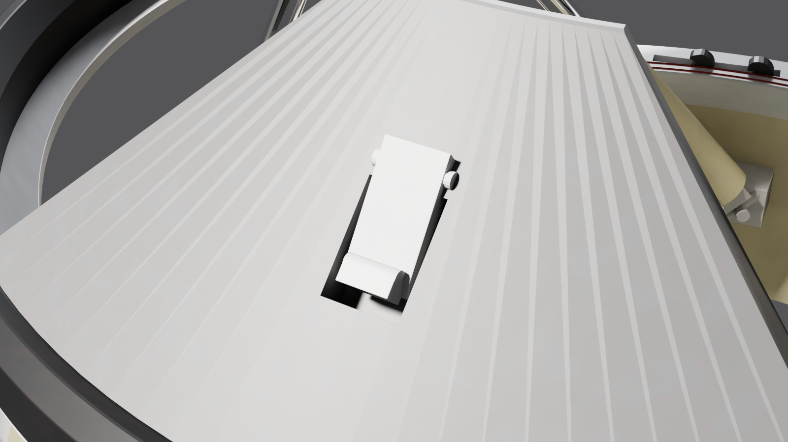
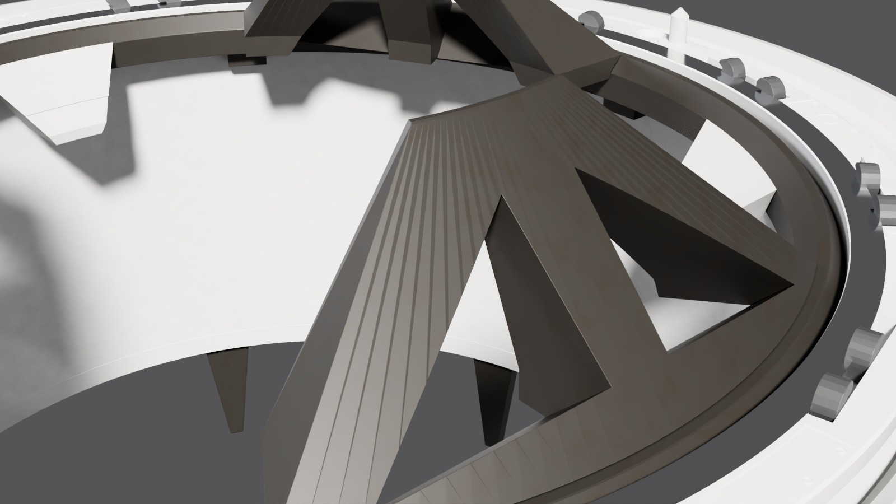
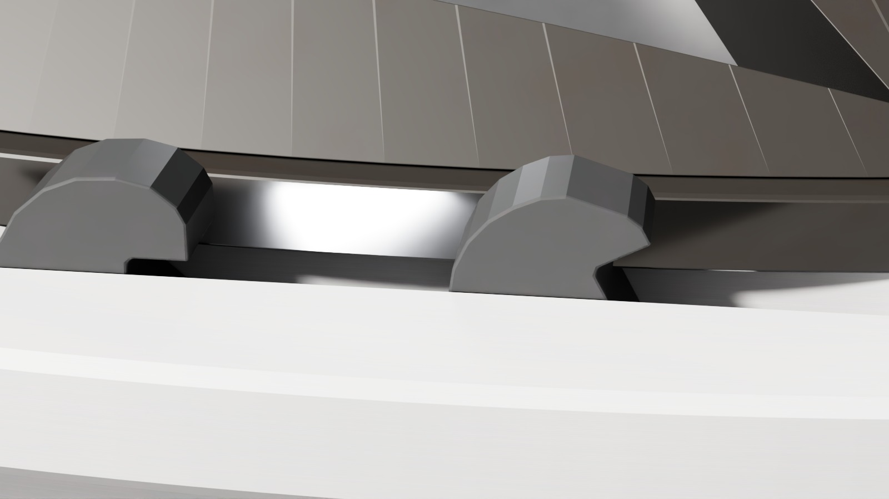

# IDSS docking system: International Docking Adapter and NASA Docking System


This repository holds simulation-ready models of both halves of an International Docking System Standard (IDSS) docking interface:

- the passive **International Docking Adapter (IDA)**, the docking port on the ISS;
- the active **NASA Docking System Block 1 (NDS)**, as flown on Boeing's Starliner.

They are built procedurally in Blender from the IDSS Interface Definition Document (IDD Rev F, 2022) and the NDS Interface Definition Document (JSC 65795 Rev H), with materials matched to NASA photographs of IDA-2 and IDA-3. Every mechanism is a working joint, and every contact surface is an explicit collider, so the whole docking sequence can be simulated:

- **Soft capture:** the NDS capture ring rides on a six-actuator Stewart platform with five closed kinematic loops. Its three guide petals slide over the IDA's truss petals and latch strikers, and the spring-loaded capture latches snap past the 2 mm striker steps.
- **Attenuation, alignment and retraction:** closed-form hexapod kinematics with actuator load feedback.
- **Hard capture:** 12 active/passive hook pairs per side. The hooks swing over each other and the active hooks pull down to preload the Belleville-sprung passive hooks to 30-40 kN each. The guide pins seat in their receptacles and the seal beads compress against the IDA's sealing land.
- **Undocking:** hooks open, latches release, and the spring separators push off.

## Quick start

Clone the repo and run the Newton example with [uv](https://docs.astral.sh/uv/). The assets in `assets/` are stored with Git LFS.

```sh
git clone https://github.com/alexmaietta/idss-docking-asset.git
cd idss-docking-asset
git lfs pull
```

Then to install Newton and run the example.

```sh
uv venv
source .venv/bin/activate
uv pip install "newton[examples]"
python examples/newton/example_idss_docking.py # full docking sequence, live loads and phases
python examples/newton/example_idss_docking.py --offset 0.08 --misalign 3 --closing-speed 0.1 --undock-after 5
```


The example loads `assets/ida/ida.usda` (fixed to the station) and `assets/nds/nds.usda` (on a free-floating 13 t crew vehicle in zero g). It runs the IDSS/NDS concept of operations as a state machine:

1. Approach
2. Contact and capture: the latches must all pass their striker steps
3. Attenuation
4. Alignment
5. Retraction to the 4.2 mm ready-to-hook gap
6. Hook gang 1, then hook gang 2
7. Hard docked
8. Optional undocking

Initial conditions default to the IDSS capture envelope: 0.08 m/s closing speed, 40 mm lateral offset and 2° misalignment. Press `u` to undock.

### Stewart platform example


```sh
python examples/newton/example_idss_stewart.py
```

The NDS soft-capture system on a test stand with six actuators with five closed loops, closed-form inverse kinematics, live actuator strokes and loads, and clamping to the actuator stroke. It also has stow, ready and demo-trajectory controls. The demo cycles the ring from ready down to just above stowed while it sways and tilts; the sway fades out on the way down, so the ring arrives level with all six actuators at the same stroke.

### MuJoCo examples

The same two examples run on plain CPU MuJoCo (`pip install mujoco`) from the exported MJCF.

```sh
python examples/mujoco/example_idss_docking.py
python examples/mujoco/example_idss_stewart.py
```

The docking example rebuilds the capture-ring chamfers as 180 exact convex sectors and the guide-pin receptacles as convex wedges, because the exported CoACD hulls are too coarse for the 0.7 mm petal clearance and 0.25 mm pin clearance (`--coacd` keeps the exported hulls). Default run: captured at 3.8 s, hard docked at 56.5 s with a 2.10 mm HCS gap and 430 kN total hook preload (gang 1 at 40 kN per hook, gang 2 at 27-40 kN); the Newton example hard docks at 42.6 s with the same gap.

## Gallery


| | |
|---|---|
|  |  |
|  |  |
|  |  |
|  |  |
|  |  |

## Capabilities

| | IDA (passive) | NDS Block 1 (active) |
|---|---|---|
| Links / joints | 43 / 42 | 65 / 64 + 5 loop joints |
| Mass | 524 kg (IDD: 526) | 323 kg (paper: 324) |
| Soft capture | fixed capture ring, 3 truss petals, 3 A286 strikers | capture ring on 6 linear actuators (Stewart platform), 3 solid PTFE-anodised petals, 3 spring-loaded capture latches |
| Hard capture | 12 active hooks (swing + pull-down), 12 passive hooks (Belleville springs) | same |
| Interface | guide pins and chamfered receptacles, flat sealing land, 3 separators, 3 contact sensors | guide pins and receptacles, dual seal beads (Ø1273/Ø1304), 3 separators, 3 contact sensors |
| Dressing | MAPAS ring with 8 guide blades, beta-cloth MLI, gold handrails, peripheral docking target, retro-reflectors, trunnions, connector panel | mounting flange, chromate-coated tunnel, hook drive train, actuator controllers |

The interface geometry follows the IDD drawings to the millimeter; `scripts/params.py` cites a figure for every value:

- petals on a 45° cone, Ø1200 to Ø800 over 200 mm;
- capture ring Ø1250, with its SCS mating flat from Ø1202 to Ø1220;
- strikers with a 2 mm catch step 114 mm from point X;
- latch catch face 115 mm up the slant;
- hook profiles traced from IDD Fig 3.2.3.4-4/-5, on R663.5 at 15° + 30k;
- guide pins Ø24.7 x 51 on Ø1375.

Where the standard is silent, values are marked `ESTIMATE` with their reasoning: the ring stroke, the Stewart-platform attachment points, and drive and spring rates.

## Contact models

Each USD asset has a `Contact` variant set:

| Variant | What it uses | When |
|---|---|---|
| `exact` (default) | Exact convex hulls and triangle meshes where the fits are sub-millimeter: petal-to-chamfer clearance 0.7 mm, 2 mm latch catch step, 0.25 mm pin clearance. Sparse SDFs for the hook profiles. | Reliable capture and hard docking |
| `sdf` | Every collider as a sparse signed-distance field (Newton `NewtonSDFCollisionAPI`) | SDF mesh-mesh contact everywhere |
| `hydro` | The SDF set with hydroelastic pressure-field contact | Smooth contact patches and pressure distributions |

Run with `--contact sdf` or `--contact hydro`. The two halves use complementary collision groups, so only IDA-NDS pairs are tested.

## Visual variants

The visuals can be cut down for simulation without touching the physics. Colliders, joints and masses are the same in every variant.

| `Fidelity` | IDA meshes / triangles | NDS meshes / triangles | What it is |
|---|---|---|---|
| `full` (default) | 82 / 158k | 124 / 143k | As built: one mesh per link per material, instanced |
| `medium` | 82 / 55k | 124 / 50k | Collapse-decimated to about 35% of the triangles, UVs kept |
| `low` | 43 / 16k | 65 / 15k | About 10% of the triangles, merged to one mesh per rigid link with a material subset per material |
| `proxy` | 82 / 1k | 124 / 1.5k | One box per part |
| `none` | 0 | 0 | No visual geometry, for headless simulation |

| `Materials` | What it is |
|---|---|
| `full` (default) | Textured UsdPreviewSurface |
| `simple` | Flat UsdPreviewSurface per material: the textures' average colour, metallic and roughness, no textures |
| `none` | No material bindings; every mesh carries its material's colour as `displayColor` |

```python
root = stage.GetDefaultPrim()
root.GetVariantSet("Fidelity").SetVariantSelection("low")
root.GetVariantSet("Materials").SetVariantSelection("none")
```

The Newton example takes them as `--fidelity` and `--materials`.

## Formats

| Format | Path | Notes |
|---|---|---|
| USD | `assets/ida/ida.usda`, `assets/nds/nds.usda` | Primary assets in the Isaac Sim robot layout. Variants: `Physics` (physics/physx/mujoco), `Fidelity` (full/medium/low/proxy/none), `Materials` (full/simple/none), `Contact` (exact/sdf/hydro). Stewart-platform loops are `excludeFromArticulation` ball joints. |
| MJCF | `assets/mjcf/{ida,nds}/`, `assets/mjcf/idss_docking_scene.xml` | Loops as `<connect>` equalities, springs as joint stiffness + springref, servos as position actuators, convex (CoACD) collision |
| URDF | `assets/urdf/{ida,nds}/` | No loops in URDF: the capture ring rides on a virtual 6-DOF chain and the actuator legs are open chains |
| Blender | `assets/blender/{ida,nds}.blend` | Source models, textures packed, collider meshes included (hidden) |

## Rebuild

You need Blender 5.2 (`BLENDER=/path/to/blender`) and a uv venv with `bpy`, `usd-core`, `newton[examples,importers,sim]`, `trimesh`, `coacd`, `scipy` and `pillow`; the renders also need `ovrtx` and `ovstage` (and ffmpeg for the MP4s).

```sh
./pipeline.sh                                  # both assets: textures -> Blender build -> export -> USD package -> thumbnail -> URDF/MJCF
./pipeline.sh nds build export package         # single steps for one asset
.venv/bin/python scripts/export_robots.py --asset nds && .venv/bin/python scripts/export_robots.py --scene   # URDF/MJCF
python examples/newton/utils/record_docking.py && ./pipeline.sh stills rtx video   # README renders (OVRTX)
```

Reference values with citations are in `refs/IDSS_SPEC.md`, and photo and material references are in `refs/HARDWARE_REFERENCES.md`. The source documents are git-ignored; re-fetch them from the URLs listed there.

### Versions and releases

The asset version lives in `VERSION`, and the packager stamps it into each USD (`assetInfo.version`, `isaac:version`, and `asset_version` in `customLayerData` / `SimReady_Metadata`). To cut a release:

1. Bump `VERSION` and run `./pipeline.sh release`. This rebuilds every format and refreshes `assets/` with the new version stamped in. It also builds the release zips in `build/release/v<VERSION>/` so you can check them.
2. Commit `assets/` and `VERSION`, tag the commit `v<VERSION>`, and push the tag.
3. The [release workflow](.github/workflows/release.yml) runs on the tag. It checks that the tag matches `VERSION` and the stamped USD, zips the committed assets (`idss-usd.zip`, `idss-urdf.zip`, `idss-mjcf.zip`, `idss-blend.zip`), and publishes the GitHub release with `SHA256SUMS`.

## Sources

- IDSS Interface Definition Document, Revision F (2022) and Revision E (2016), NTRS 20220011643 / 20170001546
- NASA Docking System Interface Definition Document, JSC 65795 Rev H (2013)
- NDS Block 1 direct-electric docking system, NDS capture latch assembly (AMS 2018), NDS linear actuator system (2017), NDS Block 2 (2026)
- NASA photographs of IDA-1/2/3 (KSC, ISS EVAs) and of Starliner and Dragon approaches (public domain)
- Space renders: ProductionCrate RenderCrate orbital HDRI (`refs/env/RenderCrate-HDRI_Orbital_34.exr`, not redistributed). Without it the space renders have a black sky and no Earth.

## License

- Code (`scripts/`, `configs/`, `pipeline.sh`, `examples/`): [Apache License 2.0](LICENSE).
- Model assets (`assets/`) and renders (`docs/images/`): [CC BY 4.0](assets/LICENSE).

This project is not affiliated with or endorsed by NASA, Boeing or the International Docking System Standard partners.
